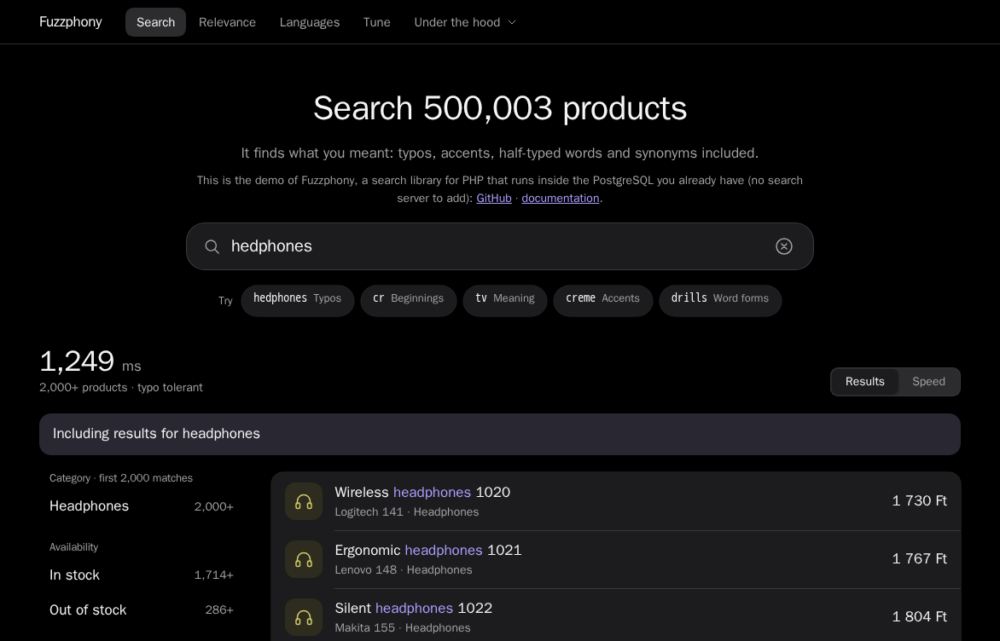
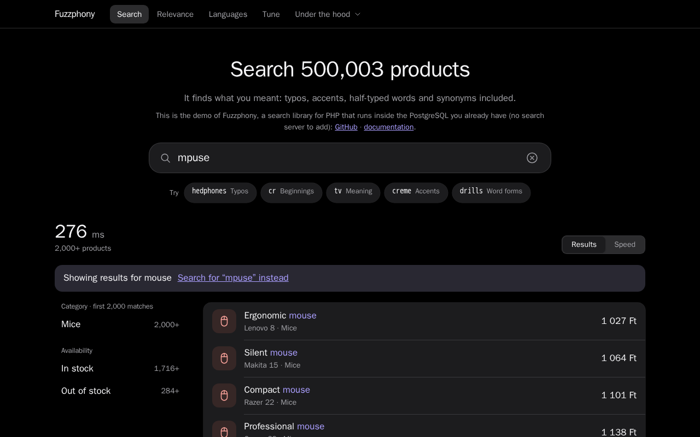
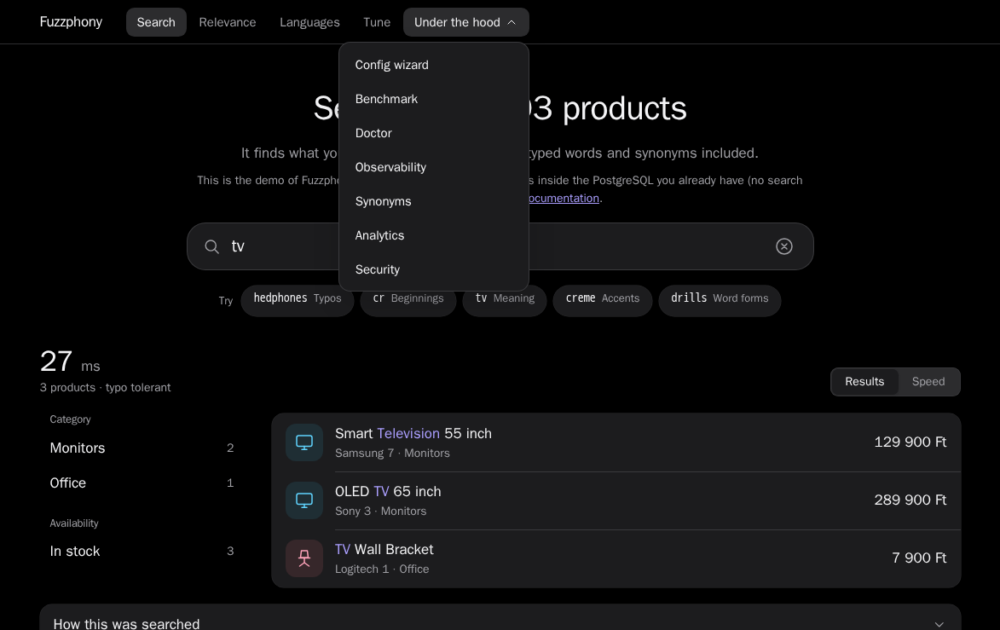
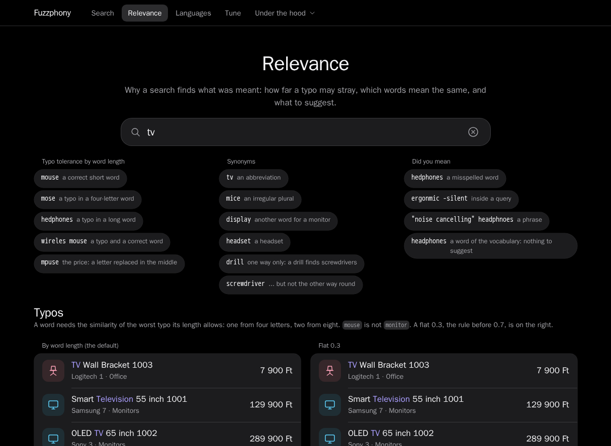
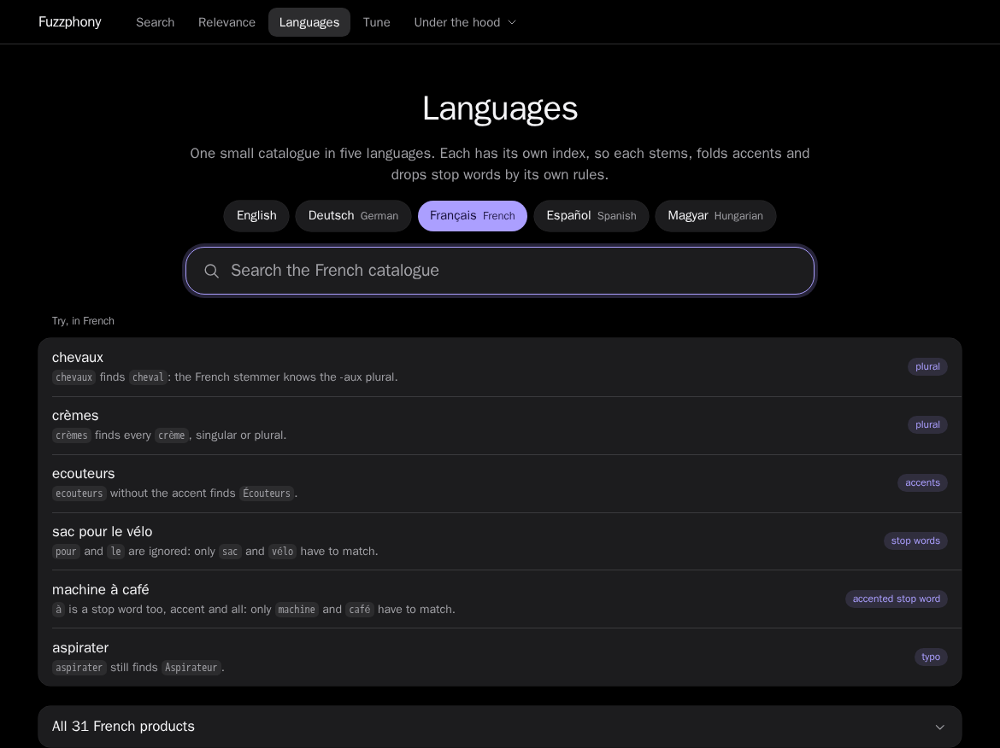
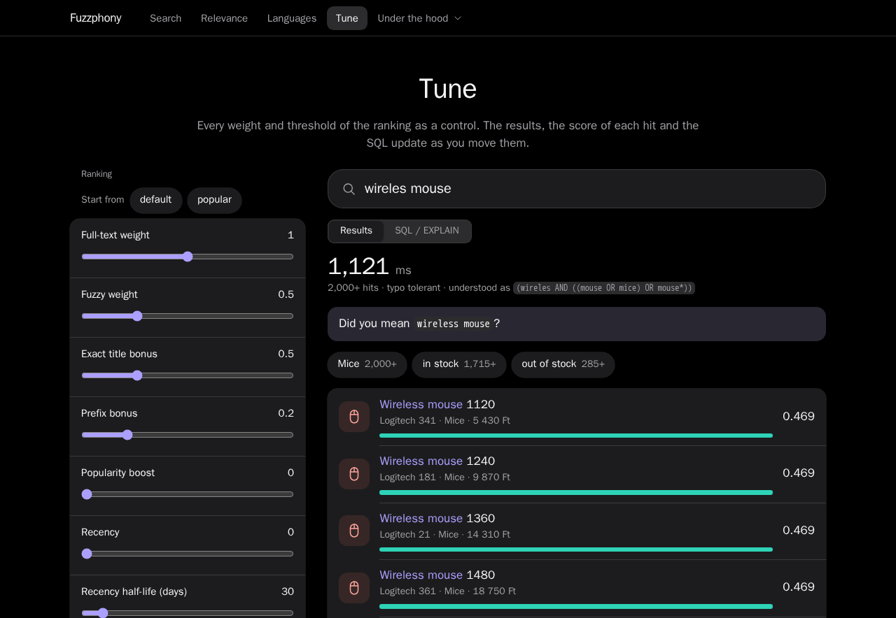

# Screenshots

What the [demo](../demo/README.md) looks like: a Symfony app on a seeded catalogue of 500 000 products, run with
`docker compose up --build` in the `demo` folder. Back to the [README](../README.md).

## Search

One search field over the whole catalogue. The results appear in place while you type, with the category and
availability facets at the side. Here the typo `hedphones` still finds headphones (the search is typo tolerant and reads the
last word as a beginning too), the highlight shows what matched, "Including results for headphones" says what the typo was
taken for, and the number at the top is how long PostgreSQL took. How the text was understood is one disclosure away ("How this was searched").

## Search: the zero-result rescue

`mpuse` (a letter replaced in the middle of `mouse`) is not found by typo tolerance, but the vocabulary has exactly one word one edit
away, so the search is run once more with it (at once, also while typing: the page says "Searching for a correction..." until it has the answer) and a bar above the
results says so: "Showing results for mouse", with a link that searches the typed text as it is (`exact=1`). See
[Zero-result rescue](searching.md#zero-result-rescue).

## Synonyms, and the "Under the hood" menu

`tv` finds the television that is called "Smart Television" and the "TV Wall Bracket": the synonyms of the catalogue are part
of the search (the expanded query, `((tv OR television OR telly) OR tv*)`, is under "How this was searched"). The open menu lists the pages that show what is
going on inside: the configuration wizard, the benchmark, the doctor report, observability, the synonym editor, the
[analytics](analytics.md) of what people searched for and the [security](security.md) example.

## Relevance

Why a search finds what was meant. Ready-made examples sit in three columns: how far a typo may stray by the length of the
word (`mouse` is not `monitor`), which words mean the same, and what "did you mean" suggests. Below, the results of the
default rule (the similarity a word needs depends on its length) stand next to the flat 0.3 of earlier versions.

## Languages

One small catalogue in five languages. Each language has its own index, so each stems, folds accents and drops stop words by
its own rules: here `chevaux` finds `cheval` (the French stemmer knows the -aux plural), `ecouteurs` without the accent finds
`Écouteurs`, and `à` is a stop word too.

## Tune

Every weight and threshold of the ranking as a control. Move a slider and the results, the score of each hit (the bar shows
where the score comes from: full text, fuzzy, bonuses) and the SQL update at once.

